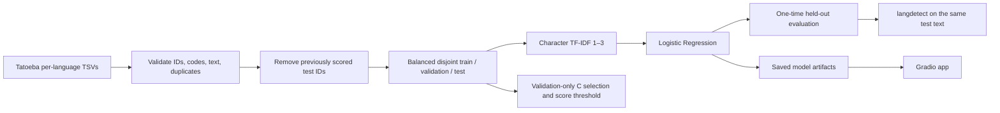

# LANGSCOPE AI

A nine-language text identifier for the AI + Languages track of the VERITAS AI International High School Hackathon 2026. Its prediction comes from a scikit-learn model, not from script-detection or keyword rules.

## Supported languages

| Language | Tatoeba code | Source rows checked |
| --- | --- | ---: |
| Amharic | `amh` | 314 |
| Mandarin Chinese | `cmn` | 89,315 |
| Japanese | `jpn` | 248,989 |
| Finnish | `fin` | 155,021 |
| Georgian | `kat` | 7,710 |
| Thai | `tha` | 6,853 |
| Swahili | `swh` | 4,583 |
| Basque | `eus` | 6,438 |
| Turkish | `tur` | 750,286 |

Afaan Oromo is excluded. Its Tatoeba export contained 10 sentences. The underlying classifier is closed-set and always ranks one of nine labels; a separate validation-calibrated gate can abstain on some unsupported or ambiguous inputs, but it cannot reliably detect every unsupported language.

## What it does

The Gradio app accepts text and shows the leading language label, the model's top score, three candidates, and an uncertainty notice. It handles blank, non-text, punctuation-only, short, and overlong inputs. The score is a Logistic Regression output, not a calibrated probability. A high score does not prove the input is one of the supported languages.

## Architecture



The final model uses `TfidfVectorizer(analyzer="char", ngram_range=(1, 3))` and `LogisticRegression(C=10.0)`. The app loads the same nine-class model plus `artifacts/tatoeba_nine/ood_rejection.json`. The classifier and the original nine-language evaluation are unchanged. The app's separate rejection gate uses the maximum raw class score and rejects scores below **0.626402**, calibrated on in-distribution validation examples and separate Tatoeba English/French OOD examples.

## Dataset and split

The project uses Tatoeba's per-language sentence exports, which contain sentence IDs, three-letter language codes, and sentence text. Tatoeba publishes its sentences under [CC BY 2.0 FR](https://creativecommons.org/licenses/by/2.0/fr/); some sentences are also CC0. See [CREDITS.md](CREDITS.md).

The classes are balanced to 258 unique sentences each: 180 train, 39 validation, and 39 test per language (2,322 total selected sentences). Amharic is the bottleneck: its 314-row export had 56 IDs already used in earlier test runs, leaving 258 eligible sentences. The other languages were downsampled to keep class counts equal. Fourteen exact normalized strings that occurred under multiple language labels were removed. Final train, validation, and test partitions have zero exact normalized-text overlap.

All IDs already scored by the earlier archived test and the superseded parser run were excluded from this final split. The superseded run is archived and is not reported as a result. **Historical independence is limited:** the earlier exploratory model used the remaining Amharic Tatoeba rows for training or validation. The final Amharic test examples are held out from this final model and were not earlier test examples, but were present in prior exploratory model development. The small Tatoeba Amharic pool does not permit a project-history-naive Tatoeba test set.

## Final evaluation

The final model was evaluated once on 351 held-out Tatoeba sentences (39 per language). It got 350 correct: accuracy **0.997151**. The balanced majority-class baseline was **0.111111**. Macro precision was **0.997222**, macro recall **0.997151**, and macro F1 **0.997151**.

| Language | Test n | Accuracy | Precision | Recall | F1 |
| --- | ---: | ---: | ---: | ---: | ---: |
| Amharic | 39 | 1.0000 | 1.0000 | 1.0000 | 1.0000 |
| Mandarin Chinese | 39 | 1.0000 | 1.0000 | 1.0000 | 1.0000 |
| Japanese | 39 | 1.0000 | 1.0000 | 1.0000 | 1.0000 |
| Finnish | 39 | 1.0000 | 1.0000 | 1.0000 | 1.0000 |
| Georgian | 39 | 1.0000 | 1.0000 | 1.0000 | 1.0000 |
| Thai | 39 | 1.0000 | 1.0000 | 1.0000 | 1.0000 |
| Swahili | 39 | 1.0000 | 0.9750 | 1.0000 | 0.9873 |
| Basque | 39 | 0.9744 | 1.0000 | 0.9744 | 0.9870 |
| Turkish | 39 | 1.0000 | 1.0000 | 1.0000 | 1.0000 |

The complete confusion matrix is [confusion_matrix.csv](artifacts/tatoeba_nine/confusion_matrix.csv). The only error was Basque `Isilik!` predicted as Swahili. It is seven characters long and had a top model score of 0.303630, below the validation threshold; the app marks it uncertain. Shortness is a plausible explanation, not a proven cause.

### langdetect comparison

The same 351 strings were passed to `langdetect` 1.0.9. It supports six target labels here and scored **215/234 = 0.918803** on those examples, for **66.7% coverage** of the full test. Amharic, Georgian, and Basque are unsupported by langdetect and are not counted as baseline errors. Its six-language scores are recorded in [metrics.json](artifacts/tatoeba_nine/metrics.json).

### Short text

These groups are from the same held-out test sentences, grouped by original text length; they are not separate test sets.

| Text length | Test n | Accuracy |
| --- | ---: | ---: |
| 1–10 Unicode code points | 46 | 0.978261 |
| 11–20 Unicode code points | 101 | 1.000000 |
| Over 20 Unicode code points | 204 | 1.000000 |

There is only one test error, so these length-group estimates are noisy. Mixed-language inputs were not evaluated: no suitable fresh, licensed, balanced test data was available.

### Unsupported-language rejection check

The original classifier is closed-set and always returns one of its nine classes. Its original **0.430643** score threshold only produced a warning; it did not reject a class prediction. For example, `How are you?` ranked Turkish first at **0.287221**, with Swahili second at **0.193134**. The app now leaves the language unassigned when the top score is below a separate OOD gate. The phrase was kept out of calibration and audit samples; all nine raw scores and its rejection decision are in [ood_rejection_evaluation.json](artifacts/tatoeba_nine/ood_rejection_evaluation.json).

The OOD gate threshold (**0.626402**) was chosen to maximize balanced accuracy between the saved nine-language validation split and 1,000 separate Tatoeba OOD calibration sentences (500 English, 500 French), subject to at least 95% in-distribution validation coverage. It retained 334/351 known-language validation examples (**95.16%**) and rejected 875/1,000 OOD calibration examples (**87.50%**). A disjoint OOD audit rejected 437/500 English examples (**87.40%**) and 435/500 French examples (**87.00%**). False accepts remain: the English sentence `I met Tom this afternoon.` passed as Finnish at 0.669752, and the French sentence `Je pense à toi en tant qu'amie.` passed as Finnish at 0.828905. This is only a caution filter, not universal language detection. Detailed sample-level scores are in `ood_calibration_predictions.csv` and `ood_audit_predictions.csv`.

This OOD check is a separate experiment. It did not use or replace the final nine-language test set, and it did not modify the classifier or `metrics.json`.

## Install and run

Python 3.14 and the pinned packages in `requirements.txt` were used.

```bash
python3 -m venv .venv
source .venv/bin/activate
python -m pip install --upgrade pip
python -m pip install -r requirements.txt
python app.py
```

Open the local URL printed by Gradio. The saved model artifacts are included in the repository, so running the app does not need the raw datasets or a Hugging Face token. On Windows PowerShell, activate with `.venv\Scripts\Activate.ps1`.

## Reproduce and inspect

Raw Tatoeba exports are excluded from Git under `data/tatoeba/`. Download the nine model-language exports plus English and French OOD exports from the [Tatoeba downloads page](https://tatoeba.org/en/downloads):

```bash
mkdir -p data/tatoeba
for lang in amh cmn jpn fin kat tha swh eus tur eng fra; do
  curl --fail --location --retry 0 \
    --output "data/tatoeba/${lang}_sentences.tsv.bz2" \
    "https://downloads.tatoeba.org/exports/per_language/${lang}/${lang}_sentences.tsv.bz2" \
    || exit 1
done
for file in data/tatoeba/*_sentences.tsv.bz2; do bzip2 -t "$file" || exit 1; done
```

`phase_tatoeba_nine_train.py` contains the data validation, train/validation tuning, calibration, and one-time evaluation pipeline. Since final test results already exist, the script refuses to run again; **do not reuse this test set**. It also requires the archived prediction files used to exclude prior test IDs. The raw archives used for the saved run are identified by SHA-256 hashes in `artifacts/tatoeba_nine/metrics.json`.

The separate OOD gate and audit can be reproduced without retraining the classifier or touching the final test set:

```bash
python calibrate_ood.py
```

It uses the saved train/validation sentence IDs and the English/French exports, excludes normalized text overlap with supported-language train/validation examples and the regression phrase, then creates deterministic, disjoint calibration/audit samples. It writes only `ood_rejection.json`, `ood_rejection_evaluation.json`, and the two OOD prediction CSVs.

Run app and artifact tests with:

```bash
python -m unittest discover -s tests -v
```

The tests check artifact loading, predictions for all nine labels, invalid and empty inputs, short/long text, the uncertainty message, saved split disjointness, and evaluation artifact consistency. They do not rerun the test evaluation.

## Limitations and next work

- The balanced corpus has 258 sentences per label, far below 2,000, because Amharic has only 314 Tatoeba rows and prior test IDs had to be excluded. Reaching 2,000 per language requires a suitable, clearly licensed additional Amharic sentence source.
- The final test is disjoint from this final model's training and validation and excludes previously scored test IDs. The Amharic rows were, however, used in an earlier exploratory model's training/validation. Treat the score as a small, project-internal held-out result, not an untouched external benchmark.
- Tatoeba sentences are short, curated examples. Real-world chats, typos, dialects, code-switching, names, and domain shift may perform differently.
- The OOD gate rejected about 87% of the sampled English and French audit examples; some unsupported inputs still pass. It was not evaluated on every language, dialect, mixed-language message, or domain, and it is not universal language detection.
- The test contains one error. The failure is preserved in `artifacts/tatoeba_nine/failure_cases.json`; no error cases have been hidden.
- Legacy FLORES+ and ten-language experiments remain under `artifacts/` for provenance and are not the current model's results.

## GitHub project metadata suggestions

Suggested repository description: “A transparent nine-language text identifier using Tatoeba, character n-gram TF-IDF, Logistic Regression, and Gradio.”

Suggested topics: `language-identification`, `nlp`, `scikit-learn`, `gradio`, `tatoeba`, `low-resource-languages`.

No software license has been selected for this repository. Do not choose one without a team decision.

## Deployment

The app has not been deployed. See [DEPLOYMENT.md](DEPLOYMENT.md) for Hugging Face Spaces setup and the correct artifact paths.
