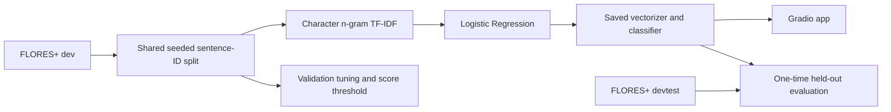

# LANGSCOPE AI

LANGSCOPE AI is a language identification demo for the AI + Languages track of the VERITAS AI International High School Hackathon 2026. It uses a trained machine learning model to rank text against ten supported FLORES+ language configurations.

## Problem

Short text can be difficult to identify reliably, especially across languages with different scripts and character patterns. This project provides a transparent, small language classifier and reports uncertainty instead of treating every model score as certain.

## Supported languages

The classifier has exactly these ten labels:

- Amharic (`amh_Ethi`)
- Afaan Oromo, West Central Oromo variety (`gaz_Latn`)
- Mandarin Chinese, Simplified/Beijing (`cmn_Hans`)
- Japanese (`jpn_Jpan`)
- Finnish (`fin_Latn`)
- Georgian (`kat_Geor`)
- Thai (`tha_Thai`)
- Swahili (`swh_Latn`)
- Basque (`eus_Latn`)
- Turkish (`tur_Latn`)

These configurations do not represent every dialect or variety. The classifier is closed-set: it always ranks these ten labels. It cannot establish that an input is in one of them, and an unsupported language can be assigned to a supported label. A high score is not proof of language membership.

## What we built

The Gradio interface accepts text and displays a predicted label, top model score, three highest-ranked labels, and an uncertainty/limitations message. The prediction itself comes from the saved character n-gram TF-IDF vectorizer and logistic regression classifier. There are no script lookup or keyword rules used to choose the predicted language.

The UI rejects blank, non-string, and punctuation/number-only input, warns when there are fewer than 20 characters, and shows the closed-set limitation on scored predictions. The 20-character advisory reflects the short-prefix evaluation below; it is a usability warning, not a guarantee about an individual input.

## Architecture and pipeline



`phase1_verify.py` inspects dataset configs and quality. `export_flores.py` exports only IDs and text for selected dataset splits. `phase2_train.py` chooses n-gram range and regularization on validation data and saves the selected pipeline. `phase4_calibrate.py` selects an uncertainty threshold from the same validation partition. `phase3_evaluate.py` performs the held-out evaluation and saves metrics, predictions, confusion matrix, and failures. `app.py` loads the saved model artifacts. The `artifacts/` directory contains those model files and outputs.

The FLORES+ `dev` split has 997 examples per language. With seed 42, a shared split of sentence IDs gives 798 train and 199 validation examples per language. The `devtest` split, with 1,012 examples per language, is reserved for final evaluation. Phase 1 reported zero empty rows, zero within-split exact duplicate sentences, and zero exact duplicates between `dev` and `devtest` for the selected configurations.

Training tried character n-gram ranges `(1, 3)`, `(2, 4)`, `(3, 5)` and logistic regression `C` values `0.1`, `1`, and `10`. The selection metric was validation macro-F1, with accuracy as a tie-breaker. The selected settings were `(1, 3)` and `C=0.1`; all nine candidates tied at validation accuracy and macro-F1 of `1.0`. The final model was fit using training examples only.

The validation-only threshold is `0.4757289252041075`. The rule maximized selective accuracy while requiring at least 95% validation coverage, breaking ties with the higher threshold. Observed validation coverage was `0.950251256281407` and selective accuracy was `1.0`. Logistic regression's `predict_proba` scores are shown as model scores; they are not guaranteed to be calibrated probabilities.

## Installation

The project was developed with Python 3.14 and pinned package versions in `requirements.txt`. In a fresh checkout:

```bash
python3 -m venv .venv
source .venv/bin/activate
python -m pip install --upgrade pip
python -m pip install -r requirements.txt
```

On Windows PowerShell, activate with `.venv\\Scripts\\Activate.ps1` instead of the `source` command.

## Run the application

From the repository root, with the environment activated:

```bash
python app.py
```

Open the local URL printed by Gradio. The saved model artifacts must exist under `artifacts/`. This project session verified artifact loading and predictions in-process, but could not verify browser access because the development sandbox denied local socket creation.

## Reproduce data preparation, training, and evaluation

FLORES+ is a gated Hugging Face dataset. First request/accept its terms and authenticate your own Hugging Face CLI account with access. Then, from the repository root:

```bash
python export_flores.py dev
python export_flores.py devtest
python phase2_train.py
python phase4_calibrate.py
python phase3_evaluate.py
```

The exporter stops if a download fails or sentence counts differ from the recorded counts. Training uses `dev`; `devtest` must remain untouched until settings and the threshold are finalized. `phase3_evaluate.py` is the final evaluation script and should only be run once for a given finalized model. Re-running training/calibration replaces corresponding files in `artifacts/`; keep a backup if you need to preserve a specific run. Raw exports in `data/flores_plus/` are ignored by Git and are not included in this repository.

Run the local automated smoke tests with:

```bash
python -m unittest discover -s tests -v
```

The seven tests passed in both the project environment and a fresh dependency target installed from `requirements.txt`. Coverage included artifact loading, one real saved example for each of the ten language labels, empty and invalid inputs, punctuation-only text, a short Unicode prefix, a real English out-of-scope request phrase, and long Unicode text. These are app smoke tests; they do not rerun the held-out evaluation.

## Existing evaluation results

These are the results already saved in `artifacts/phase3_metrics.json`; the test set was evaluated once. On 10,120 held-out examples, the classifier got 10,119 correct: accuracy `0.9999011857707509`. The single error was a Basque sentence predicted as Simplified Mandarin. Per-language metrics are in that JSON file, and `artifacts/confusion_matrix.csv` contains the confusion matrix.

The majority-class baseline accuracy was `0.1`. The external detector `langid` 1.1.6 scored `0.9997804128238911` accuracy on 9,108 supported examples. Afaan Oromo was unsupported by that detector and was excluded from its score.

On prefixes from each real test sentence, accuracy was:

| Prefix length | Accuracy | Examples |
| ---: | ---: | ---: |
| 5 Unicode code points | 0.3268774703557312 | 10,120 |
| 10 Unicode code points | 0.6575098814229249 | 10,120 |
| 20 Unicode code points | 0.9354743083003952 | 10,120 |

The five saved failure cases and cautious, qualitative explanations are in `artifacts/failure_cases.json`. The ten sample inputs and outputs in `artifacts/input_output_examples.json` are real FLORES+ `dev` examples for demonstration; they are not test metrics.

Example input/output (one saved `dev` example):

```text
Input: 周一，斯坦福大学医学院的科学家宣布，他们发明了一种可以将细胞按类型分类的新型诊断工具：一种可打印的微型芯片。这种芯片可以使用标准喷墨打印机制造，每片价格可能在一美分左右。
Predicted language: Mandarin Chinese (Simplified/Beijing)
Top model score: 0.558547
Other top candidates: Japanese 0.132334; Amharic 0.073337
```

This is one real FLORES+ `dev` sentence, not an evaluation result. The full stored values are in `artifacts/input_output_examples.json`.

## Limitations and next steps

- The benchmark uses parallel FLORES+ sentences and does not establish performance on conversational, mixed-language, misspelled, or domain-specific text.
- Prefix accuracy drops considerably for short input. The app warns below 20 characters, but longer text can still be ambiguous.
- The model only knows ten labels; the uncertainty threshold is not an out-of-distribution detector. Unsupported inputs can receive a confident-looking score.
- `gaz_Latn` represents West Central Oromo; it is not evidence of coverage across all Afaan Oromo varieties.
- The one full-sentence test error and all saved short-prefix failures remain visible in the artifacts.
- Before a public demo, run the app and smoke tests in a normal local environment, then deploy only after choosing a hosting service and reviewing public exposure of the model/data artifacts.

## Data attribution and source-code license

The dataset is [FLORES+](https://huggingface.co/datasets/openlanguagedata/flores_plus). Its card identifies the data license as [CC BY-SA 4.0](https://creativecommons.org/licenses/by-sa/4.0/); attribution, model/library references, and other credits are in [CREDITS.md](CREDITS.md). Dataset terms apply to the dataset and are not a license for this project's original source code. No separate license for the original source code has been selected in this repository.

## Deployment later

No deployment or external account setup has been performed. See [DEPLOYMENT.md](DEPLOYMENT.md) for manual Hugging Face Spaces preparation steps. No GitHub branches or settings are changed by those instructions.
