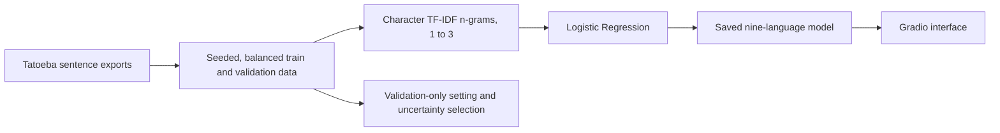

# LANGSCOPE AI

LANGSCOPE AI is a nine-language identifier for the AI + Languages track of the VERITAS AI International High School Hackathon 2026. Afaan Oromo is out of scope because the verified Tatoeba export contained only 10 West-Central Oromo sentences, which is not enough for the balanced train/validation setup used here.

## Problem and contribution

Language identification gets less reliable on short, ambiguous, and mixed-language text. This project makes its limitations visible through a validation-tuned uncertainty message and clearly labels model scores. The current classifier uses only authentic Tatoeba sentences; no text was generated or translated for the project.

## Supported languages

- Amharic (`amh`)
- Mandarin Chinese (`cmn`)
- Japanese (`jpn`)
- Finnish (`fin`)
- Georgian (`kat`)
- Thai (`tha`)
- Swahili (`swh`)
- Basque (`eus`)
- Turkish (`tur`)

It is a closed-set model: it ranks these nine classes and does not establish whether an input belongs to one of them. Languages outside this list can receive a supported-language label. Its score is not a calibrated or guaranteed probability.

## How it works



`phase_tatoeba_nine_train.py` fits a `TfidfVectorizer(analyzer="char", ngram_range=(1, 3))` and Logistic Regression. It selects regularisation and the uncertainty threshold using validation data only. `app.py` uses the saved model for predictions; no script or keyword rules choose the language. The app handles empty or non-text inputs, flags very short inputs, and displays the three highest model scores.

## Current model run

The saved nine-language model was fit on Tatoeba data with random seed 42: 243 training and 61 validation sentences per language (2,187 train and 549 validation in total). Validation selected `C=10.0`, with accuracy `0.9963570127504554` and macro-F1 `0.9963567679753932`. The validation-selected uncertainty threshold is `0.7884329824438988`; its observed validation coverage was `0.9508196721311475` and selective accuracy was `1.0`.

These are validation results only. **There are no final test-set results for this nine-language model.** The earlier ten-language Tatoeba test set has already been examined, so it cannot be reused as an untouched final test set. The older FLORES+ model and scores are preserved in the repository for traceability, but are not results for the current model. FLORES+ states that it is an evaluation benchmark and should not be used as training data. See [CREDITS.md](CREDITS.md) for dataset terms and attribution.

## Installation

Requires Python 3.14 and the pinned dependencies in `requirements.txt`:

```bash
python3 -m venv .venv
source .venv/bin/activate
python -m pip install --upgrade pip
python -m pip install -r requirements.txt
```

On Windows PowerShell, activate with `.venv\\Scripts\\Activate.ps1`.

## Run the app

From the repository root with the environment activated:

```bash
python app.py
```

Open the local URL printed by Gradio. The required model files are stored under `artifacts/tatoeba_nine/`.

## Reproduce training

Download and verify the per-language Tatoeba exports (sentence ID, language code, and sentence text) into `data/tatoeba/`:

```bash
mkdir -p data/tatoeba
for lang in amh cmn jpn fin kat tha swh eus tur; do
  curl --fail --location --retry 0 \
    --output "data/tatoeba/${lang}_sentences.tsv.bz2" \
    "https://downloads.tatoeba.org/exports/per_language/${lang}/${lang}_sentences.tsv.bz2" \
    || exit 1
done
for file in data/tatoeba/*_sentences.tsv.bz2; do bzip2 -t "$file" || exit 1; done
```

Then run:

```bash
python phase_tatoeba_nine_train.py
```

This command retrains and overwrites the current model files in `artifacts/tatoeba_nine/`. Keep a backup if preserving this exact run is important. A fresh untouched, balanced test set must be prepared before any final test evaluation. Do not run the archived ten-language `phase_tatoeba.py` experiment as a final result; its test data was already evaluated and its Oromo training supplement used FLORES+.

Run the automated smoke tests with:

```bash
python -m unittest discover -s tests -v
```

The smoke tests check loading and app behavior; they do not evaluate the held-out test set.

## Limitations and next steps

- No final test evaluation has been run for this nine-language model. Do not describe validation metrics as test performance.
- The balanced Tatoeba subset is small: only 243 train and 61 validation sentences per language. Performance beyond those examples is not established.
- Very short messages, mixed-language text, spelling variation, and domain shifts may be difficult. The current work does not include a fresh, held-out mixed-language challenge evaluation.
- Afaan Oromo is not supported. Its local Tatoeba export had 10 sentences; the pending gated AfriSwitch request has not supplied data and is not used by this project.
- Legacy FLORES+ and ten-language Tatoeba artifacts remain for traceability and must not be represented as the final results of this nine-language app.

## Attribution and licensing

Dataset attribution, licenses, model and library versions are listed in [CREDITS.md](CREDITS.md). Dataset licenses apply to the source data, not automatically to the original project code. No separate license has been selected for the original source code.

## Deployment

No deployment has been performed. See [DEPLOYMENT.md](DEPLOYMENT.md) for instructions to prepare a deployment later.
