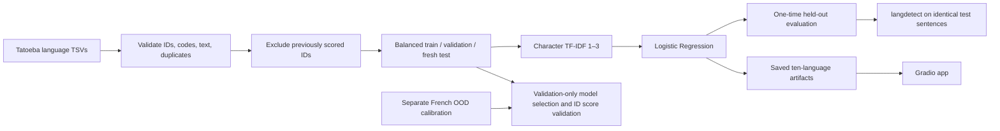

# LANGSCOPE AI

A ten-language text identifier for the AI + Languages track of the VERITAS AI International High School Hackathon 2026. Predictions come from a trained scikit-learn classifier, not script-detection or keyword rules.

## Supported languages and data

| Language | Tatoeba code | Source rows checked |
| --- | --- | ---: |
| Amharic | `amh` | 314 |
| Mandarin Chinese | `cmn` | 89,315 |
| Japanese | `jpn` | 248,989 |
| Finnish | `fin` | 155,021 |
| Georgian | `kat` | 7,710 |
| Thai | `tha` | 6,853 |
| Swahili | `swh` | 4,583 |
| Basque | `eus` | 6,438 |
| Turkish | `tur` | 750,286 |
| English | `eng` | 2,041,097 |

Afaan Oromo is excluded because its Tatoeba export had only 10 sentences. English was added as the tenth supported language so the app can identify ordinary English input such as “How are you?”.

The balanced ten-language run uses **219 unique sentences per language** (2,190 total): 153 train, 33 validation, and 33 test per language. Amharic is the limiting source. To create a fresh test set, 95 previously scored IDs in each of the original nine language exports and 1,000 English IDs already scored by the former OOD experiment were excluded. Exact repeated text within a class and 43 cross-language text collision groups were removed. Train, validation, and test have no normalized exact-text overlap. Dataset counts, checksums, and IDs are recorded in `artifacts/tatoeba_ten/`.

Tatoeba sentence rows contain IDs, three-letter language codes, and text. Tatoeba publishes sentences under [CC BY 2.0 FR](https://creativecommons.org/licenses/by/2.0/fr/); some rows are CC0. See [CREDITS.md](CREDITS.md).

## Model and application

The model is `TfidfVectorizer(analyzer="char", ngram_range=(1, 3))` followed by `LogisticRegression(C=10.0)`. Validation macro-F1 selected C from 0.1, 1.0, and 10.0. The app displays the top language, its raw model score, and three candidates. The score is not a calibrated probability.

### Reading the prediction

**Top three candidates (model scores)** lists the three supported languages with the highest Logistic Regression scores, in descending order. Each score is the model's relative class score for that input; it is not a calibrated probability, and the three scores should not be interpreted as certainty percentages.

**“Uncertain — no supported language assigned”** means the highest score was below the rejection threshold (**0.660368**). The app then withholds a language assignment, although it still shows the model's top candidates for context. The threshold was chosen using in-language validation examples and separate French Tatoeba examples. It can reject difficult or short text even when it is one of the ten supported languages, and it can still accept unsupported text. For example, “How are you?” ranks **English** first with a raw score of **0.841009**, above the threshold. This gate is a caution, not a guarantee that the input is or is not one of the supported languages.



## Final ten-language evaluation

The model was evaluated once on its new, balanced held-out test set: 330 Tatoeba sentences (33 per language). It classified **329/330 correctly**, for accuracy **0.996970**. Macro precision was **0.997059**, macro recall **0.996970**, and macro F1 **0.996969**. The balanced majority-class baseline was **0.100000**. This is a small test set drawn from the same curated source as training, not a broad real-world benchmark.

| Language | Test n | Accuracy | Precision | Recall | F1 |
| --- | ---: | ---: | ---: | ---: | ---: |
| Amharic | 33 | 1.0000 | 1.0000 | 1.0000 | 1.0000 |
| Mandarin Chinese | 33 | 1.0000 | 1.0000 | 1.0000 | 1.0000 |
| Japanese | 33 | 1.0000 | 1.0000 | 1.0000 | 1.0000 |
| Finnish | 33 | 1.0000 | 0.9706 | 1.0000 | 0.9851 |
| Georgian | 33 | 1.0000 | 1.0000 | 1.0000 | 1.0000 |
| Thai | 33 | 1.0000 | 1.0000 | 1.0000 | 1.0000 |
| Swahili | 33 | 1.0000 | 1.0000 | 1.0000 | 1.0000 |
| Basque | 33 | 0.9697 | 1.0000 | 0.9697 | 0.9846 |
| Turkish | 33 | 1.0000 | 1.0000 | 1.0000 | 1.0000 |
| English | 33 | 1.0000 | 1.0000 | 1.0000 | 1.0000 |

There was one error: the five-character Basque sentence `Ikasi` was predicted as Finnish with score 0.297268; the gate leaves it uncertain. The error and full confusion matrix are in `artifacts/tatoeba_ten/failure_cases.json` and `confusion_matrix.csv`.

### langdetect baseline

`langdetect` 1.0.9 received exactly the same 330 test sentences. Three target labels—Amharic, Georgian, and Basque—are unsupported by that library and were omitted from its accuracy denominator. It scored **213/231 = 0.922078** on the seven supported labels (70% test coverage). Its per-language metrics are in `artifacts/tatoeba_ten/metrics.json`.

### Short test sentences

These are groups within the same test set, not additional evaluations. At most 10 characters: **44/45 (0.977778)**; 11–20 characters: **84/84**; over 20 characters: **201/201**. These estimates are noisy because there are only 33 test examples per language.

### Out-of-distribution check

The score gate threshold (**0.660368**) retains 314/330 in-language validation examples (**95.15%**). On a separate French calibration sample, it rejected 232/500 (**46.4%**); a disjoint French audit rejected 217/500 (**43.4%**). Many French inputs still pass as supported, so the gate cannot establish that a language is outside the ten supported classes. This check did not use the ten-language test set. Full sample-level results are under `artifacts/tatoeba_ten/ood_*`.

### Preserved nine-language results

The previous nine-language model and evaluation remain unchanged in `artifacts/tatoeba_nine/`. Its original result was 350/351 correct (accuracy 0.997151). Those examples were not reused in the ten-language test set. The current app loads the new ten-language artifacts at `artifacts/tatoeba_ten/`.

## Install and run

Python 3.14 and pinned packages from `requirements.txt` were used.

```bash
python3 -m venv .venv
source .venv/bin/activate
python -m pip install --upgrade pip
python -m pip install -r requirements.txt
python app.py
```

Gradio prints the local URL. Runtime does not need raw datasets or a Hugging Face token. On Windows PowerShell, activate using `.venv\Scripts\Activate.ps1`.

## Reproduce

Raw Tatoeba exports are excluded from Git under `data/tatoeba/`. Download the ten model-language exports and French OOD export from the [Tatoeba downloads page](https://tatoeba.org/en/downloads):

```bash
mkdir -p data/tatoeba
for lang in amh cmn jpn fin kat tha swh eus tur eng fra; do
  curl --fail --location --retry 0 \
    --output "data/tatoeba/${lang}_sentences.tsv.bz2" \
    "https://downloads.tatoeba.org/exports/per_language/${lang}/${lang}_sentences.tsv.bz2" \
    || exit 1
done
for file in data/tatoeba/*_sentences.tsv.bz2; do bzip2 -t "$file" || exit 1; done
```

The saved one-time experiment is documented in `phase_tatoeba_ten_train.py`; its existing metrics make it refuse to retrain or reuse the test set. The separate OOD calibration is `calibrate_ood_ten.py`. The prior nine-language pipeline and results are retained separately.

Run the checks with:

```bash
python -m unittest discover -s tests -v
```

## Limitations

- Amharic limits the balanced experiment to 219 sentences per language, well below 2,000.
- The test set is small and uses curated Tatoeba sentences. Chats, typos, dialects, names, code-switching, and domain changes may behave differently.
- `langdetect` does not support three target labels; its score covers only seven languages.
- The French OOD gate accepts more than half of the separate audit examples. It is not universal language detection.
- Mixed-language input was not separately evaluated. Very short messages can be inherently ambiguous even when English is supported.
- The repository has no selected software license. Tatoeba's data terms do not license the project's original code.

## GitHub metadata suggestions

Description: “A ten-language text identifier using Tatoeba, character n-gram TF-IDF, Logistic Regression, and Gradio.”

Topics: `language-identification`, `nlp`, `scikit-learn`, `gradio`, `tatoeba`, `low-resource-languages`.

No source-code license has been selected. The app has not been deployed; see [DEPLOYMENT.md](DEPLOYMENT.md) for preparation instructions.
